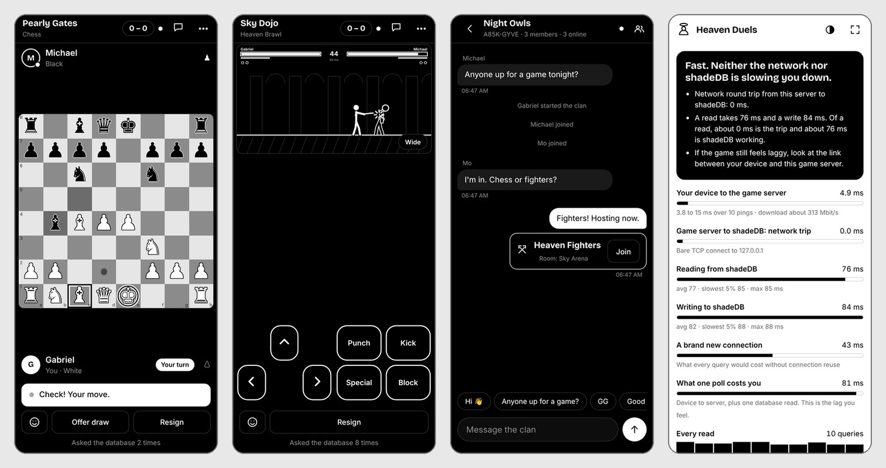
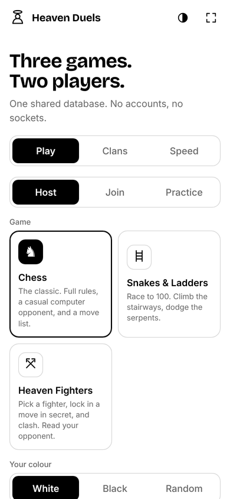
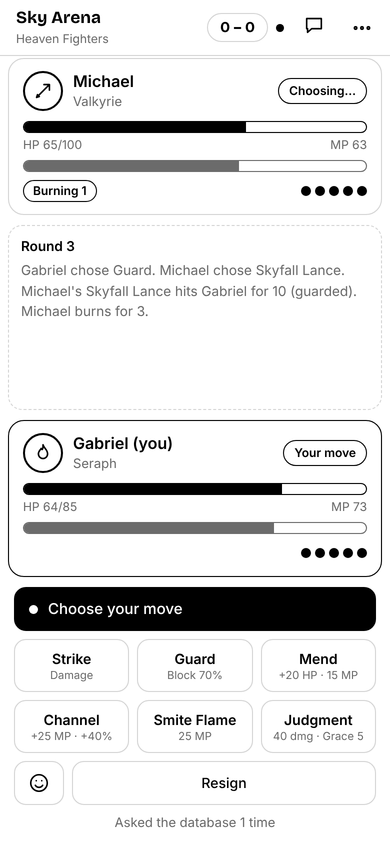
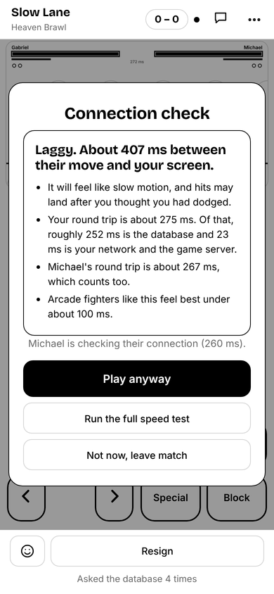
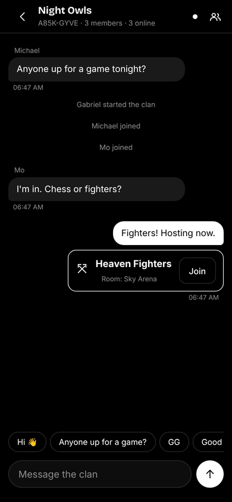
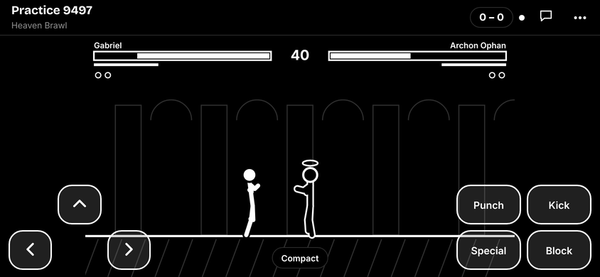
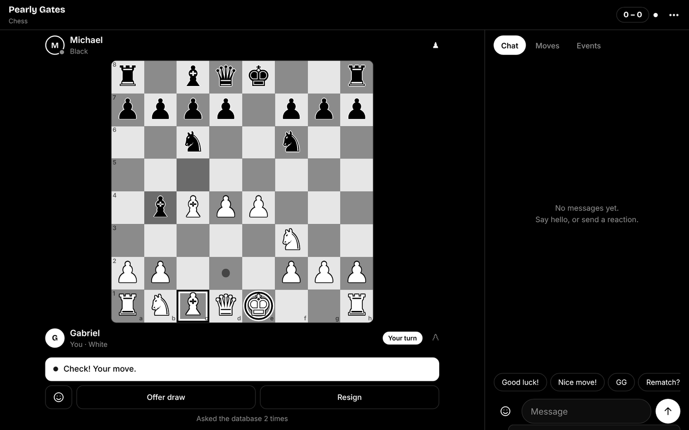

# Heaven Duels

A chess app, a Snakes & Ladders app and two fighting games: a turn-based duel and a real-time arcade brawler. Two players, one shared database, no accounts, no websockets, no server-sent events, no push of any kind.

Every move is a database write. The other player's client asks the database what changed, about once a second. The counter in the game ("Asked the database N times") shows how often it asked, and the board still feels live.

Even the real-time brawler, Heaven Brawl, runs this way: each player writes their own small record about twenty times a second and reads the other's. That is about as far as polling can be pushed, so the game checks your connection before every match and lets you decide whether to play.

**Built on [shadeDB](https://shadedb.duckdns.org)** by [@shade_ofc](https://x.com/shade_ofc). It is the only channel between the players. Moves, chat, reactions, rematch requests, clans and who is online are all records in shadeDB, so there is nothing else to run: no socket server, no message broker, no sessions to keep alive. Close your tab, come back tomorrow, and your game is still there.



<p align="center">
  
  
  
  
</p>



On a laptop the chat and move list dock beside the board, and the layout adapts from a small phone to a wide monitor:



## Quick start

```bash
git clone https://github.com/harkerbyte/duels
cd duels
chmod 700 ./start.sh
./start.sh
```

`start.sh` creates a virtualenv, installs the two dependencies, starts the server and opens your browser at `http://localhost:5000`. The first time, it also writes a ready-made `.env` that points at the **shared demo database**, so the game works straight after cloning with nothing to sign up for. You need Python 3.10+ on Linux, macOS, Android (Termux), or Windows via WSL or Git Bash.

| Command | What it does |
| --- | --- |
| `./start.sh` | Plays on the shared demo database, writing `.env` for you the first time |
| `./start.sh --custom` | Uses **your own `.env`** (your own shadeDB). The script never writes to it |
| `./start.sh --offline` | Local storage only. No network or database needed |
| `./start.sh --lan` | Also lets other devices on your network join (prints your address) |
| `./start.sh --demo` | Replaces `.env` with the demo one (your old one is kept as `.env.bak`) |
| `./start.sh --write-env` | Writes the demo `.env` and stops. Handy before `docker compose up` |
| `docker compose up --build` | Runs it in a container (it needs a `.env`: run `./start.sh --write-env`, or copy `.env.example` and fill in your own) |

### About the demo database

The credentials for the demo database are written into `start.sh` on purpose, so the game works out of the box. That means **they are public**: anyone with this repository can read, write and delete in that database. Rooms, clans and chat there are not private, so do not put anything you care about in them. The game tells you when you are on it.

**Want your own?** Make an instance and a partition in the [shadeDB dashboard](https://shadedb.duckdns.org), copy `.env.example` to `.env`, fill it in, and start with `./start.sh --custom`. The script will not touch your file. If you run `./start.sh` with a `.env` of your own and no flag, it stops and asks you to choose, rather than quietly using the demo database or overwriting yours.

Publishing your own fork with its own demo? Replace the `DEMO_*` values at the top of `start.sh` with a dedicated, disposable token that can only reach one partition, and rotate it if it is ever abused.

## Playing

The lobby has three tabs: **Play**, **Clans** and **Speed**.

1. On **Play**, pick a game, then **Host** a room with a name (and optionally a password), or **Join** one by name. **Practice** starts a solo game against the computer.
2. Share the room name, or tap **Share invite** (on the waiting card, or in the menu) to send a link that opens the join form with the name filled in. If you are in a clan, the menu can post the invite straight into its chat.
3. Take turns. The page asks the database for the room about once a second, so your opponent's move appears as soon as it is saved.
4. Chat in the room, send reactions, and rematch when it ends. Scores carry across rematches and the starting side swaps each game.

If an opponent disappears for 45 seconds you can claim the win. Rooms with a password only let in players who know it, and passwords are stored as salted PBKDF2 hashes.

**Leaving a room.** When you host, a switch decides what happens when you leave: **Delete the room when I leave** (on by default) removes the room from the database and sends your opponent back to the lobby. With it off, the room stays: an unfinished game ends with a win for the player who stayed, and the room is deleted when they leave too. When a guest leaves, their seat opens up for someone else. Practice rooms are always deleted.

### Chess

Full rules: castling, en passant, promotion (with a piece picker), check, checkmate, stalemate, the fifty-move rule, threefold repetition and insufficient material. Tap a piece to see its legal moves. You also get a move list, captured pieces with a material count, resign, and draw offers. Choose White, Black or Random when you host. The computer opponent is casual: it looks two moves ahead (three in endgames), which is good for practice rather than a challenge.

### Snakes & Ladders

The classic 10x10 board, with stairways and serpents. Roll with the server's dice (so nobody can cheat), land exactly on 100 to win, and a six gives you another turn.

### Heaven Fighters

A turn-based duel where both players choose at the same time. First each picks a fighter, without seeing the other's choice. Then every round both lock in a move in secret, and the round resolves when the second move lands. The database never has to deliver anything faster than a person can think, which is why a fighting game works with no real-time channel at all. Your opponent's pending move and pick never leave the server until they are revealed.

| Fighter | HP | MP | Ability |
| --- | --- | --- | --- |
| Paladin | 120 | 40 | Radiant Bulwark: 8 damage and a 25 point shield that protects you this round |
| Seraph | 85 | 70 | Smite Flame: 20 damage and burning (3 a round for 3 rounds) |
| Valkyrie | 100 | 45 | Skyfall Lance: 24 damage, 50% more against a channelling target |
| Cherub | 90 | 50 | Feint: 15 damage through guard, steals 10 MP |

| Move | Effect |
| --- | --- |
| Strike | Class-based damage |
| Guard | Take 70% less from attacks, +10 MP |
| Mend | +20 HP and puts out burning (15 MP) |
| Channel | +25 MP and your next attack deals +40%, but you take 25% more this round |
| Ability | Your fighter's special move |
| Judgment | 40 damage that ignores guard. Needs 5 Grace |

Grace grows by 1 each round and by 1 more when you take damage. Everyone regenerates 6 MP a round. All the numbers live at the top of `games/fight.py`.

### Heaven Brawl

A real-time arcade fighter in the spirit of the classic 2D ones. Pick a fighter, win two rounds of 45 seconds (or have more health when the clock runs out) and the match is yours. It is the most demanding thing you can do over a database, so it is **opt-in at every step**:

- **It checks your connection first.** Before each match both players run a short test of real round trips. It tells you in plain words how far behind your opponent's moves will arrive and whether that comes from your network or from the database, and you choose **Play**, **Play anyway** (when it expects lag) or leave. Both players must tap ready before the countdown starts, so nobody is pushed into a laggy fight. **Run the full speed test** inside the check shows the whole breakdown.
- **On-screen controls.** A d-pad (left, right, jump) and four buttons (Punch, Kick, Special, Block), with multi-touch so you can move and attack at the same time. On a keyboard use the arrows or WASD, J K L (or Z X C), and Down to block.
- **Wide mode.** Tap **Wide** (or pick it in the menu) and the arena fills the screen with the controls floating over the corners. It is meant for a phone turned sideways in full screen, and switches on by itself when you hold the phone in landscape.
- **Practice against the computer** needs no network at all.

| Fighter | HP | Special |
| --- | --- | --- |
| Paladin | 130 | Shield Bash: a heavy lunge |
| Seraph | 100 | Fireball: a projectile |
| Valkyrie | 110 | Spear Thrust: the longest reach |
| Cherub | 95 | Dash Strike: fast and slippery |

Punch is quick and short, Kick is slower and hits harder, Special costs energy (which refills over time), and Block takes most of the damage from a hit but never lets chip damage finish you off.

## Clans

A clan is a named group with a unique **cable ID** such as `K7QM-X2NA`. Start one on the **Clans** tab and you get an ID to hand out. Anyone who plugs in with it joins the clan.

- **Chat.** Message the whole clan, with quick replies. Game invites show up as a card with a Join button.
- **Who is around.** The member list shows who is online, who owns the clan, and a log of who joined and left. If the owner leaves, the clan passes to whoever has been in it longest. The last person out deletes it, and an owner can disband it.
- **No accounts.** Joining gives your browser a token for that clan, kept on your device. Clearing browser data means plugging back in with the cable ID.
- **Under the hood.** A clan is one shadeDB record (`cl_<id>`) holding the members, the join and leave history (last 60 events) and the chat (last 80 messages). Members ask the database what changed, exactly like a room. Up to 40 members, one message a second each.

## Speed test: is it the database or my network?

The **Speed** tab runs real queries and tells you where the time goes. It reports, separately:

| Measurement | What it tells you |
| --- | --- |
| Your device to the game server | Your link to whoever runs the game (about 0 ms if you host it yourself) |
| Game server to shadeDB: network trip | A bare TCP connect to the database host. This is the network, with no database work in it |
| Reading from and writing to shadeDB | Full queries on a warm connection, with average, slowest 5% and max |
| A brand new connection | What each query would cost without connection reuse |
| What one poll costs you | Device to server plus one database read: the lag you actually feel |

Then it decides. If a read is 150 ms or less and a write 250 ms or less, it says things are fast. Otherwise it compares the network trip with the whole read: when the trip is more than about half of it, the network is the bottleneck, and when it is not, shadeDB is taking longer than the network accounts for. Run it a few times, since one run is a sample. **Copy results** puts a text summary on your clipboard, handy for a bug report.

It writes to one scratch record, `hd_bench`, in your partition. In offline mode there is no database trip to measure, so it times the local file instead and says so.

## The interface

- **Black and white, flat.** No gradients or glows. The theme follows your device (light or dark); change it from the lobby or the menu.
- **Made for phones.** The game fills the screen with no page scrolling, the board scales to the space available, and it works in portrait, landscape, tablets and desktops.
- **Full screen.** On phones the game goes full screen when you start (the lobby button and the in-game menu toggle it). On iPhone, use Share, then Add to Home Screen, for the same effect. Android and desktop browsers can also **Install app**, which launches it with no browser bars. The screen stays awake during a game.
- **Chat and reactions.** A chat sheet (docked beside the board on wide screens) with bubbles, times, quick replies, an emoji picker and an unread badge. Tap the smiley under the board to send an emoji that floats across your opponent's screen.
- **Small touches.** A waiting-room card with a share button, a result card with Rematch, sounds and vibration on joins and turns (switch them off in the menu), a flip-board option, and the lobby remembers your name, game and colour.

## How it works

```
 browser ──poll──►  Flask server  ──HTTPS──►  shadeDB (partition "duelers")
 browser ◄─state──  (rules + auth)  ◄─room──   one record per room or clan
```

- A room is one shadeDB record: `{"room": "hd_pearly_gates", "data": "<room JSON>"}`. A clan is the same shape with a `cl_` key. Everything the players share lives in it.
- Every event is a write to that record: a move, a chat message, a reaction, a resignation, a rematch, and a small "I'm here" heartbeat every few seconds.
- Nothing is pushed. Each client asks `GET /api/room/<key>` about once a second, and the server answers from the database with only what that player may see, such as their own legal moves. That is ordinary polling, and it is the whole trick: a request that is cheap enough to repeat makes the game feel live.
- The browsers never talk to shadeDB themselves. The Flask server checks each move against the rules, does the write, and reads the room back. It holds no game state of its own that the other player needs, so the only thing that travels between players is shadeDB data.
- The server keeps one HTTPS connection to shadeDB open per thread and reuses it, so a query costs one network round trip instead of a new TCP and TLS handshake each time. On a slow link that is the difference between a snappy game and a laggy one (the speed test shows the saving).
- Caching, cache invalidation, scaling, replication and access control are all shadeDB's job. The game server adds no cache of its own by default, so each poll is a real read and the counter in the game counts real questions put to the database.
- With `--offline` the same flow runs against a local file instead of shadeDB.

### Real-time play (Heaven Brawl)

Each player's device simulates their own fighter, so your controls answer instantly. As often as the link allows (up to about every 40 ms) it sends the fighter's position and state to the server, which writes it to that player's own shadeDB record and, in the same request, reads the opponent's record. Your opponent is drawn a fraction of a second in the past and smoothed between their updates, which hides the gaps. The attacker's device decides when a hit connects and the defender's device decides what it does to them (a block gets a small grace to allow for lag), so nobody waits on a referee. The host's device keeps the round clock, measured against the server's clock so both screens count down together.

Expect a tenth to a quarter of a second between their move and your screen on a good connection, which is exactly what the connection check reports. It is a friendly game, not a tournament one: a modified client could cheat.

### Staying connected

The page keeps working through a bad connection. If a request fails it retries in the background with a growing delay, shows **Live**, **Reconnecting** or **Offline** beside the room name, and refreshes the instant you come back online or return to the tab. Nothing is lost, because the game lives in the database. When the server ships a newer version of the page, open tabs refresh themselves.

## Configuration

By default `start.sh` writes `.env` for you, pointing at the shared demo database. To use your own database, create an instance and a partition (the game uses `duelers`) in the [shadeDB dashboard](https://shadedb.duckdns.org), copy `.env.example` to `.env`, fill it in, and run `./start.sh --custom`.

| Variable | Meaning |
| --- | --- |
| `SHADEDB_ENDPOINT` | Your `https://.../connect/<instance id>` endpoint |
| `SHADEDB_DBID` | Database id (defaults to the last part of the endpoint) |
| `SHADEDB_CONNECTION_TOKEN` | Connection token |
| `SHADEDB_CLUSTER_TOKEN` | Cluster token. A token with READ, WRITE, UPDATE and DELETE is enough |
| `SHADEDB_PARTITION` | Partition for rooms and clans, default `duelers` |
| `SHADEDB_TIMEOUT` | Seconds to wait for one database request (10) |
| `PORT`, `HOST` | Server port (5000) and bind address (127.0.0.1) |
| `HD_MODE=offline` | Force local storage |
| `HD_CACHE_TTL` | Off by default (0): every poll is a real read, and shadeDB does the caching. Set a small number of seconds only if you hit rate limits |

Mark the `room` field as **unique** in your partition. Creating a room or clan then fails cleanly if two people pick the same name at once, and it guarantees one record per room. `python scripts/check_db.py` tells you whether it is set.

**Keep your own `.env` private.** It is in `.gitignore`, and the tokens are only ever used by `store.py`. If a token of yours has been shared or committed, delete that cluster in the dashboard and create a new one. (The demo credentials in `start.sh` are the exception: they are public by design, see above.)

## Offline and online

- **Online:** rooms and clans live in shadeDB, so players anywhere can play and sessions survive server restarts.
- **Offline:** everything lives in a local `.local-db.json`. Practice works anywhere, and with `--lan` friends on the same network can join your machine.

To let friends on other networks play, run the server where they can reach it (a small server, a container, or a tunnel). They connect to your game server, never to the database directly. Run **one server process per database**, because rooms are locked per process. The Docker image does this with a single gunicorn worker.

## Troubleshooting

- **Heaven Brawl feels laggy.** The connection check before the match says how much. Run the **Speed** tab to see whether the network or the database is slow. A closer router, fewer other apps, or running the game server near your database all help.
- **It feels laggy.** Open the **Speed** tab. It tells you whether the time goes to the network, to shadeDB, or to your link to the game server.
- **The owner does not see a joiner, or the joiner is kicked out a moment after joining.** The server was reading an older copy of the room from shadeDB. That happens when `room` is not a unique field (two records for one room) or when a read lags behind a write. As a safety net the server prefers the newest copy it wrote and writes it back, and it logs `WARNING: N records share room=...` or `stale read for ...` when that happens. Run `python scripts/check_db.py` and mark `room` as unique if it says it is not.
- **"The database said ERR_..."**: the message shows shadeDB's error code. `ERR_PARTITION_NOT_EXIST` means the partition in `.env` does not exist, `ERR_MAINTENANCE_ACTIVE` and `ERR_INGESTION_PAUSED` mean maintenance is on, and `HTTP_403` means a token is wrong or expired.
- **Free instances are rate limited.** The server backs off and retries. If you still hit limits, set `HD_CACHE_TTL` to a second or so so polling clients share one read.

## Project layout

```
app.py              Flask routes: rooms, moves, chat, resign, draws, rematch, leave
clans.py            clans: cable IDs, members, history, chat, invites
bench.py            the speed test and its verdict
store.py            shadeDB client (persistent connections) and the local file store
games/chess.py      chess engine and computer opponent
games/snakes.py     Snakes & Ladders rules
games/fight.py      Heaven Fighters rules and computer opponent
games/brawl.py      Heaven Brawl: fighter picks and the match result
realtime.py         per-player sync records for Heaven Brawl
static/brawl.js     the Brawl engine, controls and connection check (loaded on demand)
static/index.html   the whole front end (no build step)
static/fonts/       Inter and Bricolage Grotesque, bundled so it looks the same offline
static/sw.js, manifest.webmanifest, icons/   install-as-app and offline shell
tests/              unit tests, including a fake shadeDB endpoint
scripts/            check_db.py
docs/               screenshots
start.sh            one-command launcher
```

## API at a glance

| Area | Endpoints |
| --- | --- |
| Rooms | `POST /api/create` `join` `move` `resign` `draw` `chat` `emote` `rematch` `claim` `leave`, `GET /api/room/<key>` |
| Clans | `POST /api/clan/create` `join` `chat` `leave` `disband`, `GET /api/clan/<cable id>` |
| Speed | `GET /api/ping`, `GET /api/bench/blob`, `POST /api/bench/run` |
| Real-time | `POST /api/brawl/sync` |
| Other | `GET /api/meta` |

## Testing

```bash
python -m unittest discover -s tests
```

No network or credentials needed. The chess engine is checked against published perft node counts for five standard positions, which exercise castling, en passant and promotion, and shadeDB is replaced by a small fake endpoint (`tests/fake_shadedb.py`) built from its public docs. It can misbehave on purpose, serving stale or duplicate records, to prove the stale-read guard works.

## Adding a game

A game is one file in `games/` with `TITLE`, `BLURB`, `new_state(first)`, `apply(state, slot, move, names)` returning `(error, log_lines, end)`, `bot_move(state, slot)` and `view_state(state, viewer)`, plus an entry in `games/__init__.py`. If both players move at once, also provide `can_act(state, slot)`. The server calls `view_state` per player, so hide anything a player should not see there. Rooms, chat, passwords, rematches, clans and storage come for free; the board itself is a view in `static/index.html`.

## Contributing

Pull requests and ideas are welcome. Read [CONTRIBUTING.md](CONTRIBUTING.md) first; security problems go through [SECURITY.md](SECURITY.md). Follow along, or tell the author what you built, on X: [@shade_ofc](https://x.com/shade_ofc).

## Credits

Backend, persistence and cross-client communication by [shadeDB](https://shadedb.duckdns.org), the self-managing cloud database with its own native query language. Made by [@shade_ofc](https://x.com/shade_ofc).

Fonts: [Inter](https://rsms.me/inter/) and [Bricolage Grotesque](https://github.com/ateliertriay/bricolage), both under the SIL Open Font License. Licence texts are in `static/fonts/`.

## License

[MIT](LICENSE).
